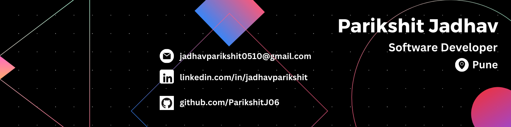

# Hey there! 👋 I'm Parikshit Jadhav

<h1 align="center">Parikshit Jadhav</h1>
<h3 align="center">AI Engineer | Agentic AI | Generative AI | Backend Engineering</h3>

  Building intelligent AI systems, agentic workflows, and LLM-powered applications.

  
  

---

### 👨‍💻 About Me

I'm an **AI Engineer** focused on building intelligent applications using Large Language Models (LLMs), Agentic AI, and Generative AI technologies.

I enjoy exploring how AI systems work under the hood and engineering solutions that combine LLMs, tools, APIs, and backend infrastructure.

- 🤖 Working on Generative AI and Agentic AI applications.
- 🧠 Building LLM-powered systems using LangChain, LangGraph, and model APIs.
- 🔧 Exploring MCP, tool calling, and agent orchestration.
- 📚 Interested in RAG, vector databases, and context engineering.
- ⚙️ Developing backend services and APIs using Python and FastAPI.
- ☁️ Exploring cloud infrastructure and scalable AI application architectures.
- 📄 Co-authored research on LLM applications in financial forecasting.

### 🛠️ Technical Skills

**Artificial Intelligence & LLM Engineering**
- Generative AI (GenAI)
- Agentic AI and AI Workflows
- Large Language Models (LLMs)
- Retrieval-Augmented Generation (RAG)
- Tool Calling and Function Calling
- Model Context Protocol (MCP)
- Prompt Engineering
- Vector Databases

**AI Frameworks & Libraries**
- LangChain
- LangGraph
- Pydantic
- FastAPI

**LLM Providers & APIs**
- Anthropic API (Claude)
- OpenAI API

**Programming Languages**
- Python
- Java
- JavaScript
- C++
- SQL

**Backend & Databases**
- FastAPI
- Spring Boot
- Node.js
- Express.js
- MongoDB
- MySQL
- Vector Databases

**Cloud & DevOps**
- AWS
- Docker
- Git & GitHub
- Postman

### 🚀 What I'm Currently Exploring

- Building intelligent agents with LangGraph and tool orchestration.
- Understanding LLM internals, context management, and agent execution.
- Designing reliable AI workflows with error handling and state management.
- Exploring MCP-based integrations and AI agent interoperability.
- Improving LLM application performance, scalability, and reliability.
- Understanding model serving, inference optimization, and cloud deployment.

---

### 📚 Research & Publications

**Harnessing LLMs for Financial Forecasting: A Systematic Review of Advances in Stock Market Prediction and Portfolio Optimization**

Co-authored research paper exploring the evolving applications of Large Language Models in financial analysis and forecasting.

**Authors:**
- Prof. Maheshwari Divate
- Parikshit Jadhav
- Ashutosh Jha
- Sachin Joshi
- Krushna Dara

**Institution:** Department of Information Technology, Dr. D. Y. Patil Institute of Technology, Pimpri, Pune, India.

**Research Focus:**
- Evolution of NLP techniques into modern LLM-based financial applications.
- Applications of LLMs in stock market prediction and financial analysis.
- Financial news, market data, and sentiment analysis.
- Risk assessment, fraud detection, and investment decision-making.
- LLM-based portfolio optimization.
- Challenges involving real-time processing, accuracy, and interpretability.

**Keywords:** Large Language Models, Financial Market Prediction, Risk Management, Algorithmic Trading, Portfolio Optimization.

🔗 **[Read the Research Paper](https://www.ijraset.com/best-journal/harnessing-llms-for-financial-forecasting-a-systematic-review-of-advances-in-stock-market-prediction-and-portfolio-optimization)**

---

### 📊 GitHub Statistics

  

  

  

  

---

### 🤝 Connect With Me

  
  
  
  

  <i>Building intelligent systems, exploring new ideas, and learning every day. 🚀</i>

